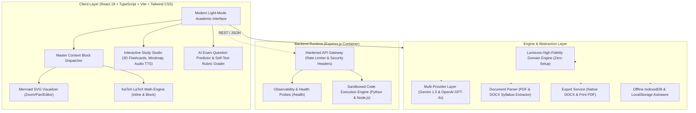

# 🎓 Lumixora Notes AI — Enterprise Academic Intelligence Platform

[](https://github.com/249xa33106-bit/NOTES/actions)
[](https://opensource.org/licenses/MIT)
[](https://nodejs.org/)
[](https://react.dev/)
[](https://www.docker.com/)

**Lumixora Notes AI** is a production-ready, full-stack academic study platform engineered to generate syllabus-aligned, mathematically rigorous study notes, 100-mark university model question papers, and past-year exam recurrence analytics for any academic discipline.

---

## 🏛️ System Architecture



---

## 🚀 Key Industry Features

| Feature | Description | Enterprise Standard |
| :--- | :--- | :--- |
| **Universal Multi-Discipline Generator** | Generates detailed notes for Computer Science, Mathematics, Electrical, Mechanical, Physics, Chemistry, Biology, Economics, and Law. | Automated domain detection; code suppression for purely theoretical topics. |
| **100-Mark University Model Paper** | Synthesizes standard university examination papers (PART A: 10 $\times$ 2M = 20M, PART B: 5 $\times$ 16M = 80M with either/or choice). | Anna University, JNTU, VTU, KTU & NBA curriculum compliance. |
| **AI Answer Rubric Evaluator** | Interactive practice scratchpad where students draft solutions and receive real-time objective scoring against examiner milestones. | Evaluates theorem statement, schematic, derivation, and boundary limits. |
| **Mathematical Proofs & Derivations** | Native KaTeX rendering for integrals, matrices, limits, summations, and Laplace transforms. | Zero typographical artifacts; full KaTeX mathematical typesetting. |
| **Interactive Mermaid Diagrams** | Architectural graphs, AVL rotation models, and state diagrams rendered as dynamic SVGs. | Zoom, pan, fullscreen preview, copy SVG, and live diagram editing. |
| **Sandboxed Code Execution** | Real in-browser Python and JavaScript execution sandbox with resource guards. | 4.5s execution timeout, 512KB buffer cap, and hazardous call filter. |
| **Native Word (.docx) & PDF Export** | One-click real `.docx` generator with cover pages, tables, callout boxes, and model answers. | Uses Microsoft Word OpenXML (`docx`) standard. |
| **3D Flashcards & Mindmaps** | Flippable active recall cards with mastery tracker and interactive visual knowledge graph. | Anki `.tsv` export; direct section jumping. |
| **SpeechSynthesis Audio Lecture** | In-browser text-to-speech lecture player with playback speed toggles (1x, 1.25x, 1.5x). | Zero external API cost; runs directly in browser. |

---

## 🐳 Quickstart with Docker Compose

Run the entire production stack (Frontend Nginx + Backend API + Sandbox) with a single command:

```bash
# 1. Clone repository
git clone https://github.com/249xa33106-bit/NOTES.git
cd NOTES

# 2. Launch production containers
docker compose up -d --build
```

Access services:
- **Frontend Web Application**: [http://localhost](http://localhost) (Port 80)
- **Backend API & Health Probe**: [http://localhost:3001/health](http://localhost:3001/health) (Port 3001)

To view logs:
```bash
docker compose logs -f
```

To stop containers:
```bash
docker compose down
```

---

## 💻 Local Development Setup

### Prerequisites
- **Node.js**: v20 LTS or higher
- **Python**: 3.9+ (Optional, for local Python execution sandbox)
- **npm** or **pnpm**

### Step-by-Step

```bash
# 1. Install dependencies
npm install

# 2. Start Frontend Dev Server (Vite)
npm run dev

# 3. In a separate terminal, start the Backend Service
npm run server
```

The application will be live at:
- Frontend: `http://localhost:5173/`
- Backend: `http://localhost:3001/`

---

## 🧪 Production Verification & Build

```bash
# Typecheck with zero TypeScript errors
npx tsc --noEmit

# Execute production build
npm run build
```

---

## 🌐 Environment Variables

Copy `.env.example` to `.env`:

```bash
cp .env.example .env
```

| Variable | Default | Description |
| :--- | :--- | :--- |
| `NODE_ENV` | `production` | Runtime mode (`development` / `production`). |
| `PORT` | `3001` | Express backend port. |
| `CORS_ORIGIN` | `*` | Allowed CORS origins (comma-separated for production). |
| `VITE_API_BASE_URL` | `http://localhost:3001` | Backend URL used by frontend. |
| `GEMINI_API_KEY` | *(Empty)* | Optional Google Gemini API key. |
| `OPENAI_API_KEY` | *(Empty)* | Optional OpenAI API key. |

---

## 🛡️ Production Security Standards

1. **Security Headers**: Express backend employs `X-Content-Type-Options: nosniff`, `X-Frame-Options: DENY`, `X-XSS-Protection`, and `Referrer-Policy`.
2. **Rate Limiting**: In-memory rate limiter configured at 120 requests/minute per IP with automatic memory cleanup.
3. **Execution Sandbox**: Subprocess execution enforces strict timeouts (4.5s), buffer caps (512KB), and filters dangerous system calls (`os.system`, `execSync`).
4. **Nginx Security**: Static assets served with immutable 1-year caching; fallback SPA routing protects against directory traversal.

---

## 📄 License

This project is licensed under the **MIT License** — see the [LICENSE](LICENSE) file for details.
